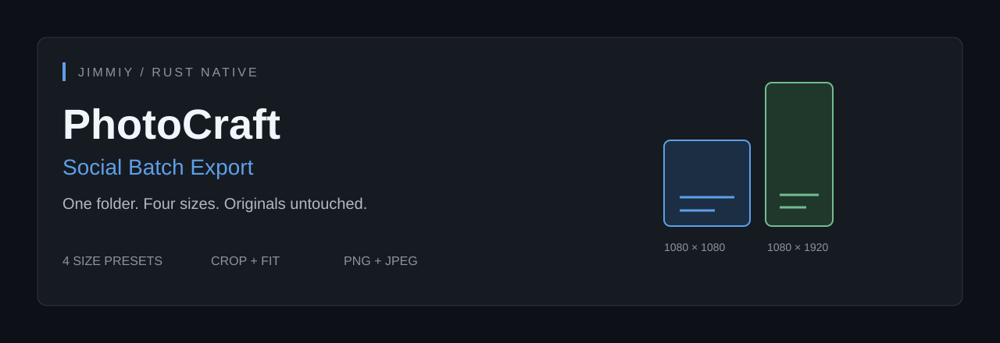

<div align="center">



**Rust-native photo editing, with safe social-media batch export.**

[](https://www.rust-lang.org/)
[](LICENSE-MIT)

[Quick start](#quick-start) · [Feature guide](docs/jimmiy/social-batch-export.md) · [Launch post](docs/jimmiy/launch-post.md) · [Verification](docs/jimmiy/verification.md)

</div>

## What this project is

This is **Jimmiy's feature fork of [PhotoCraft](https://github.com/storytold/photocraft)** by the ArtCraft team and contributors, based on upstream commit `99e1138877e6aa7e856c6883b415e708d042fc59` (0.8.2). The original editor, PSD engine, egui UI and wgpu compositor are upstream work — not claimed as newly written here.

The new work in this fork is **Social Batch Export**: a native dialog, a Rust engine command, a CLI subcommand, safety checks, background progress, per-file reports and regression tests. No Electron, Tauri, JavaScript UI or cloud service is added.

> PhotoCraft itself is early alpha. This fork is not a complete Photoshop replacement. Social export is native-only; the browser build cannot access local folders.

## Social Batch Export

| Preset | Output size |
|---|---|
| `instagram-post` | 1080 × 1080 |
| `instagram-portrait` | 1080 × 1350 |
| `story` | 1080 × 1920 |
| `youtube-thumbnail` | 1280 × 720 |

- **Crop:** aspect-preserving resize to cover, then a centred crop.
- **Fit:** aspect-preserving resize to contain, then padding with a chosen colour.
- **PNG / JPEG** export, with a 0–12 JPEG quality setting.
- **No recorded action required.** Pick a source folder and destination.
- **Non-destructive:** scratch documents leave your editor session and source files alone.
- **No overwrites:** existing files, symlinks and duplicate output names are reported as failures. Temporary-file publication uses no-clobber persistence.
- **Background jobs:** file-count progress and cancellation checkpoints between stages.
- **Honest results:** per-file errors/warnings; CLI returns a nonzero status for partial failures.

## Quick start

Install a current stable Rust toolchain (upstream requires Rust 1.95+), Git, and your platform's desktop dependencies. See [upstream development notes](docs/development.md) for platform requirements.

```sh
git clone https://github.com/jimi18102010-commits/photocraft.git
cd photocraft
cargo run --release -p photocraft
```

Open **File → Automate → Social Batch Export…**. Enter source/destination folders, choose a preset and resize mode, then confirm. Existing outputs are never silently replaced — choose a fresh output folder for another run.

### Command line

```sh
cargo run --release -p photocraft-cli -- social-export \
  --in ./photos --out ./exports \
  --preset youtube-thumbnail --mode fit \
  --format jpg --quality 10 --background '#191919' --json
```

Output names look like `photo-youtube-thumbnail.jpg`. Folder scans are non-recursive. `--quality` here uses the engine's **0–12** scale, unlike the older `convert` command's 1–100 scale.

### Engine command

```json
{
  "command": "file.automate.socialExport",
  "params": {
    "input": ["photo.png", "other.jpg"],
    "output": "exports",
    "preset": "instagram-post",
    "mode": "crop",
    "format": "png"
  }
}
```

The command is registered with the engine and native UI. Sandboxed MCP/control transports intentionally keep filesystem-bearing engine commands blocked; this fork does not weaken that security policy. Use the native UI or trusted local CLI.

## Tests and build

```sh
cargo fmt --all -- --check
cargo test -p photocraft-engine social_export_cmds --lib
cargo test -p photocraft-cli --test cli social_export
cargo test -p photocraft-ui-egui social_ --lib
cargo clippy -p photocraft-engine -p photocraft-cli -p photocraft-ui-egui --all-targets -- -D warnings
cargo xtask layers
```

See [verification](docs/jimmiy/verification.md) for the actual local results and limits. A focused GitHub Actions workflow checks the feature and packages unsigned Linux/Windows CLI binaries as workflow artifacts; configuring a workflow is not a claim that its remote run has passed.

## Scope and limitations

- Existing upstream PSD, layers, filters and colour-management capabilities remain available.
- Extreme panoramic crops are refused before oversized intermediate allocations; use fit.
- Cancellation stops future work, but does not delete files already exported.
- Source folders are not watched, recursive scanning is not implemented, and no AI generation is claimed.
- Signed installers, a new GitHub Release, and full cross-platform professional QA are not claimed.

## Credits and license

Original PhotoCraft: © 2026 ArtCraft Team and PhotoCraft contributors. This feature fork adds work for Jimmiy. Source remains **MIT OR Apache-2.0**. Keep [NOTICE](NOTICE), [LICENSE-MIT](LICENSE-MIT), [LICENSE-APACHE](LICENSE-APACHE), and [ATTRIBUTION.md](ATTRIBUTION.md).

Restricted ArtCraft wordmark/logo assets were removed from this modified distribution in accordance with their license. This fork is not an official ArtCraft product and is not endorsed by the upstream team. The original source attribution and license notices are preserved.
